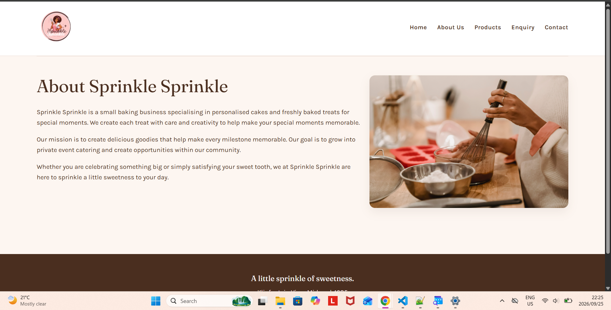
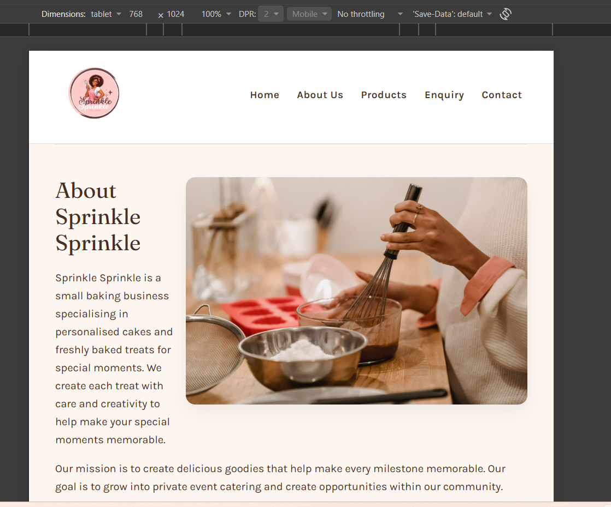
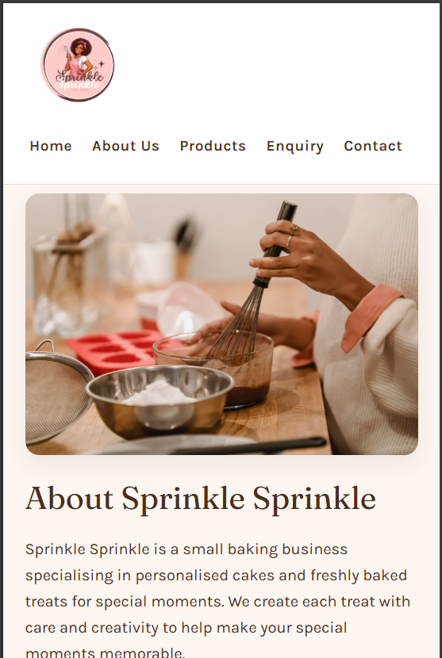

# Sprinkle Sprinkle Website

## Student Information

**Student Number:** ST10501473  
**Student Name:** Katlego Christa Mahlabegoane  
**Module:** WEDE5020w

 
---

## Project Overview

Sprinkle Sprinkle is a small baking business specialising in custom baked cakes and freshly baked desserts. The business provides personalised baked products for birthdays, graduations and other celebrations, as well as everyday treats.

The business does not currently have a website. The purpose of this project is to create a visually appealing website that showcases Sprinkle Sprinkle's products and makes it easy for customers to enquire about and place orders, strengthening the business's online presence.

This repository contains Parts 1, 2 and 3 of the Website Project POE. ***Part 1*** focused on planning, research, content gathering and building the HTML structure of the website. ***Part 2*** focused on CSS styling and responsive design. ***Part 3*** focused on adding JavaScript functionality, form validation, user interaction and SEO improvements.

Live Website: [Sprinkle Sprinkle](https://katlegochrista.github.io/ST10501473-WEDE5020w_POE)
---

## Website Goals and Objectives

* Establish an online presence for the business.
* Promote and showcase the products offered.
* Attract new customers.
* Make it easy for customers to enquire about custom orders.
* Sell products through increased enquiries and orders.

---

## Key Performance Indicators

* **Website Traffic:** Monitor the number of visitors to the website each month.
* **Enquiry Submissions:** Track the number of customers who complete and submit the enquiry form.
* **Conversion Rate:** Measure the percentage of website visitors who proceed to make an enquiry or order.
* **Number of Orders:** Monitor the number of confirmed orders received through the website.
* **Customer Growth:** Track the number of new customers gained through the website and online presence.

---

## Pages and Features

The website consists of six HTML pages, linked by a consistent navigation menu on every page:

* **Home** (`index.html`) — Hero banner, short "About" teaser, product category previews (Cupcakes, Bento, Custom Cakes, Desserts), and call-to-action links through to the Enquiry and Contact pages.
* **About Us** (`about.html`) — Background on Sprinkle Sprinkle, its mission, and a photo of the baker at work.
* **Products** (`products.html`) — Product categories (Cupcakes, Bento Cakes, Custom Cakes, Desserts) with photos, descriptions, starting prices and an "Enquire" link for each category. JavaScript functionality allows customers to search, filter and sort products. Product images can also be viewed in an interactive lightbox with captions and navigation controls.
* **Enquiry** (`enquiry.html`) — A detailed enquiry form covering customer details, product/order selection, cake flavour/frosting/filling customisation, occasion, preferred date, design description, an inspiration image upload, delivery vs collection, delivery address, dietary requirements/allergies, additional notes, and a required policy-agreement checkbox before submission. JavaScript validates the form fields, checks the information entered and displays a personalised confirmation after successful submission.
* **Contact** (`contact.html`) — Business email, phone number and physical location, plus a link through to the Enquiry form. The contact form includes JavaScript validation, a character counter and submission feedback.
* **Policy** (`policy.html`) — Terms covering orders and enquiries, lead times, deposits and payments, custom designs, allergies, delivery and collection, delivery charges, cancellations and refunds, order changes, and product variation. JavaScript accordion functionality allows customers to expand and collapse policy sections.

---

## Design and User Experience

The website uses a soft, welcoming design intended to reflect the Sprinkle Sprinkle bakery brand.

**Colour scheme** (based on the business logo): light pink, brown and cream/white, applied consistently across headers, buttons, cards and the footer using CSS custom properties (variables) for easy maintenance.

**Typography:** "Fraunces" (a soft serif) for headings, and "Karla" (a clean sans-serif) for body text, both loaded from Google Fonts.

**Layout:** built with a combination of Flexbox and CSS Grid, including a responsive product card grid and a flexible hero section.

**Responsive design:** the layout adapts across three breakpoints — desktop, tablet (900px) and mobile (640px) — using relative units (`rem`, `%`, `clamp()`) so text and spacing scale smoothly between screen sizes.

Each page follows a consistent structure of header (logo + navigation), main content area, and footer with the business address and copyright notice.

JavaScript was also used to improve the user experience through interactive product browsing, image lightboxes, expandable policy sections and form feedback. Accessibility was considered by including keyboard controls, visible focus states and reduced-motion support.

---

---

## Responsive Design Screenshots

**Desktop**

**Tablet**

**Phone**

## Technical Requirements

* **HTML** — used to build the structure and content of all six pages.
* **CSS** — used to style the website via a single external stylesheet (`style.css`), including a CSS reset, custom properties, typography, layout (Flexbox/Grid), visual styling, interactive states (`:hover`, `:focus-visible`, `:active`), and responsive breakpoints.
* **JavaScript** — used to add interactive functionality, including product search, filtering and sorting, image lightboxes, policy accordions, form validation, character counters and submission handling.
* **SEO** — implemented through page-specific titles and meta descriptions, appropriate heading structure, descriptive image alt text, internal links, a `robots.txt` file and an XML sitemap (`sitemap.xml`).
* **Google Fonts** — used to load the Fraunces and Karla typefaces.
* **JavaScript** — planned for a later part of the project to add interactivity, including enquiry form validation and submission handling.
* **Visual Studio Code** — used to create and edit the website files, with browser DevTools used to test and refine CSS during development.
* **Git / GitHub** — used for version control and to store the project.
* **Web Hosting** — GitHub Pages will be used to deploy the completed website for free.

---

## Folder Structure

* **Website/**
  * `index.html`
  * `about.html`
  * `products.html`
  * `enquiry.html`
  * `contact.html`
  * `policy.html`
  * `style.css`
  * `robots.txt`
  * `sitemap.xml`
  * `README.md`
  * `CHANGELOG.md`
  * **js**
    * `script.js`
  * **Images/**
    * `Logo.png`
    * `Homepage-hero.jpg`
    * `sprinkle-sprinkle-about.jpg`
    * `cupcake-preview.jpg`
    * `cupcakes-box-6.jpeg`
    * `cupcakes-box-12.jpg`
    * `bento-cakes-preview.jpg`
    * `piggy-bento-cake1.jpg`
    * `blue-calender-bento-cake2.jpg`
    * `custom-cake-preview.jpg`
    * `heart-custom-cake1.jpg`
    * `babyshower-custom-cake2.jpg`
    * `pink-custom-cake3.jpg`
    * `dessert-preview.jpg`
    * `banana-loaf.jpg`
    * `brownies.jpg`
* **Proposal/**
  * `ST10501473.docx`
* **Chosen proposal/**
  * `ST10501473 proposal.docx`
  * `Wireframe.pdf`

--- 

## Sitemap

* **Home**
  * About Us
  * Products
  * Enquiry
  * Contact
  * Policy

---

## CSS Features

The CSS was used to improve the appearance, layout and responsiveness of the website.

The stylesheet includes:

* CSS reset.
* CSS variables for colours and fonts.
* Typography styling.
* Header and navigation styling.
* Button styling and interactive states.
* Homepage hero section.
* About section styling.
* Product cards and product previews.
* Enquiry and contact sections.
* Enquiry form styling.
* Policy page styling.
* Footer styling.
* Responsive design for smaller screens using media queries.
* Keyboard focus styling.
* Reduced-motion support.

The website uses the Fraunces and Karla fonts from Google Fonts.

## Timeline and Milestones

* **14/08/26** — Choose organisation *(Completed)*
* **18/08/26** — Research content, plan website, download images, and research domain and hosting costs *(Completed)*
* **19/08/26** — Create HTML files and folders and add website content *(Completed)*
* **20/08/26** — Test website and fix errors *(Completed)*
* **21/08/26** — Review PoE Part 1 and prepare submission *(Completed)*
* **21/09/26** — Prepare README and folder structure for GitHub *(Completed)*
* **22/09/26** — Create external stylesheet, apply colour scheme and typography *(Completed)*
* **23/09/26** — Build layout and responsive styling across all pages *(Completed)*
* **24/09/26** — Test and correct CSS across all pages and screen sizes *(Completed)*
* **25/09/26** — Finalise CHANGELOG and README for Part 2 submission *(Completed)*
* **31/10/26** — Add JavaScript functionality, including product search, filtering and sorting, image lightboxes and policy accordions *(Completed)*
* **01/11/26** — Implement JavaScript form validation, character counters and submission handling *(Completed)*
* **01/11/26** — Apply SEO improvements, including page titles, meta descriptions, image alt text, `robots.txt` and `sitemap.xml` *(Completed)*
* **02/11/26** — Test website functionality, forms and responsive layouts *(Completed)*
* **02/11/26** — Update README and CHANGELOG for Part 3 *(Completed)*
* **02/11/26** — Deploy the website using GitHub Pages *(Completed)*

---

## Changelog

* A separate `CHANGELOG.md` file has been included in the project to record the main changes and development stages of the website.

---

## References

OnStrategy (2024) *KPIs Meaning + 27 Examples of Key Performance Indicators*. Available at: https://onstrategyhq.com/resources/27-examples-of-key-performance-indicators/ (Accessed: 19 August 2026).

Domains.co.za (2026) *Online Costs*. Available at: https://www.domains.co.za/blog/online-costs/ (Accessed: 20 August 2026).

**Images**

Unsplash (2026) *Cupcakes hero image*. Available at: https://images.unsplash.com/photo-1516130236945-09b0ae334c1e (Accessed: 19 August 2026).

Pexels (2026) *White icing covered cupcake on plate*. Available at: https://www.pexels.com/photo/white-icing-covered-cupcake-on-plate-592392/ (Accessed: 19 August 2026).

Pexels (2026) *Bento cake preview image*. Available at: https://images.pexels.com/photos/29617080/pexels-photo-29617080.jpeg (Accessed: 19 August 2026).

Pexels (2026) *Custom cake preview image*. Available at: https://images.pexels.com/photos/7180854/pexels-photo-7180854.jpeg (Accessed: 19 August 2026).

Pexels (2026) *Banana loaf image*. Available at: https://images.pexels.com/photos/5419311/pexels-photo-5419311.jpeg (Accessed: 19 August 2026).

Pexels (2026) *Chef image used on the About page*. Available at: https://images.pexels.com/photos/6578868/pexels-photo-6578868.jpeg (Accessed: 19 August 2026).

Pexels (2026) *Red velvet cupcakes in a box*. Available at: https://www.pexels.com/photo/festive-red-velvet-cupcakes-in-a-box-37992494/ (Accessed: 19 August 2026).

Pexels (2026) *Piggy face bento cake*. Available at: https://www.pexels.com/photo/cute-piggy-face-cake-in-eco-friendly-box-29208774/ (Accessed: 19 August 2026).

Pexels (2026) *Bento cake image*. Available at: https://images.pexels.com/photos/16473482/pexels-photo-16473482.jpeg (Accessed: 19 August 2026).

Pexels (2026) *Brownies image*. Available at: https://images.pexels.com/photos/11762843/pexels-photo-11762843.jpeg (Accessed: 19 August 2026).

Pexels (2026) *Custom cake image*. Available at: https://images.pexels.com/photos/28983248/pexels-photo-28983248.jpeg (Accessed: 19 August 2026).

Pexels (2026) *Custom cake image*. Available at: https://images.pexels.com/photos/15067881/pexels-photo-15067881.jpeg (Accessed: 19 August 2026).

Pexels (2026) *Custom cake image*. Available at: https://images.pexels.com/photos/30226868/pexels-photo-30226868.jpeg (Accessed: 19 August 2026).
